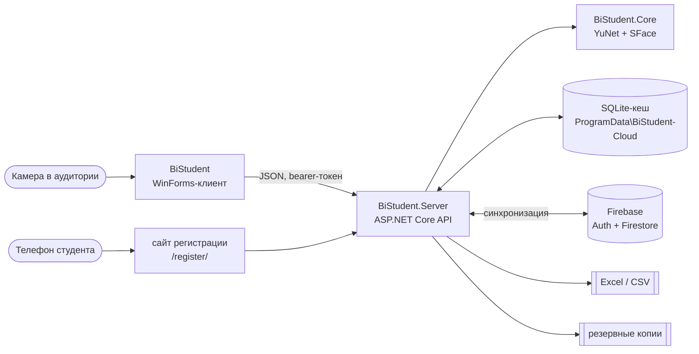

<div align="center">

# BiStudent

Электронный журнал преподавателя колледжа: посещаемость отмечается по распознаванию лиц, оценки и итог ведутся там же, журнал выгружается в Excel для печати. Данные всех преподавателей сводятся в облаке Firebase, а без интернета программа работает офлайн.


</div>

## Зачем

Перекличка в начале пары занимает пять минут, бумажный журнал потом переписывают в Excel, а пропуски по уважительной причине теряются между справками и сообщениями. BiStudent отмечает присутствующих камерой в аудитории, ведёт оценки в том же журнале и в конце семестра выдаёт готовый лист для печати.

## Что умеет

**Отметка посещаемости.** Камера в аудитории распознаёт студентов группы и ставит «П», остальным в конце занятия ставится «Н». Преподаватель видит, кого программа узнала, и может исправить любую отметку вручную.

**Уважительные причины.** Пропуск можно оформить как уважительный: болезнь, семейные обстоятельства, учебная или служебная необходимость, другое. К причине прилагаются отметка о документе и комментарий, в журнале такое «Н» выделено жёлтым.

**Журнал.** Посещаемость, баллы за занятия по 100-балльной шкале, контрольные мероприятия (тесты, контрольные работы, экзамены, зачёты) и итоговый балл. Справа считаются пропущенные часы, процент посещаемости и средний балл. «Скачать Excel» формирует лист для печати с шапкой, обозначениями и строкой подписи.

**Регистрация лиц по коду.** Преподаватель выдаёт группе код или QR-код. Студенты сами делают три снимка на сайте с телефона или компьютера, сервер сразу проверяет качество, преподаватель подтверждает заявку.

**Облако.** Вход идёт через Firebase Authentication, журналы, расписание и группы синхронизируются через Firestore раз в минуту и по нажатию на значок «☁» в боковой панели. Без интернета всё сохраняется локально и отправляется, когда связь вернётся. Преподаватель на своём ноутбуке видит то же, что администратор на компьютере колледжа.

**Импорт.** Списки групп загружаются из журнала Excel или CSV, расписание из файла колледжа. При импорте расписания для новых преподавателей создаются учётные записи. Тот же файл расписания второй раз не загрузится, а новое расписание заменит старое и не тронет уже выставленные отметки.

**Учётные записи и копии.** Администратор заводит преподавателей и выдаёт временные пароли. Сервер раз в сутки делает резервную копию, вручную её можно скачать и восстановить в разделе «Администрирование».

## Скачать

**[BiStudent-win-x64.zip](https://github.com/logreus-cloud/BiStudent-public/releases/latest/download/BiStudent-win-x64.zip)** для Windows 10/11 x64. Распакуйте архив целиком и запустите `BiStudent.exe`: откроется окно входа. Устанавливать ничего не нужно, .NET уже внутри.

Войдите логином и паролем, которые выдал администратор. Для первого входа нужен интернет: программа проверяет пароль в Firebase и загружает из облака группы, расписание и журналы. Потом можно работать и без сети. Самый первый вход в новый проект Firebase делает администратор: `admin` / `admin`, после чего программа попросит сменить пароль.

Сервер лежит в папке `Server` рядом с программой. Клиент запускает его сам, без отдельного окна, и закрывает при выходе. Первый запуск занимает до полуминуты, следующие несколько секунд.

Программа не подписана. Если Windows покажет «Windows защитила ваш компьютер», нажмите «Подробнее» → «Выполнить в любом случае». Брандмауэр спросит про BiStudent.Server: разрешите доступ, иначе студенты не откроют сайт регистрации с телефона.

Новая версия собирается автоматически после каждого push в `main`, все версии лежат в [Releases](https://github.com/logreus-cloud/BiStudent-public/releases).

## Запуск из исходников

Нужны Windows x64 и .NET 10 SDK.

```powershell
git clone https://github.com/logreus-cloud/BiStudent-public
cd BiStudent-public
.\scripts\run-demo.ps1 -Demo     # без облака, демо-данные на пустой базе, вход teacher / teacher123
```

Скрипт собирает решение, поднимает сервер на порту 5080 и открывает клиент преподавателя. Когда клиент закрывается, сервер останавливается. С ключом `-Demo` Firebase выключен, чтобы демо-данные не попали в общую облачную базу.

<details>
<summary>Остальные режимы и команды</summary>

| Команда | Что делает |
|---|---|
| `.\scripts\run-demo.ps1` | рабочий режим с облаком: вход учётной записью Firebase, база в `C:\ProgramData\BiStudent-Cloud` |
| `.\scripts\run-demo.ps1 -Demo` | без облака, на пустой базе `C:\ProgramData\BiStudent` создаёт демо-данные: группы, расписание, историю посещаемости и оценок |
| `.\scripts\run-demo.ps1 -Reset` | удаляет локальную базу перед запуском (с `-Demo` — демо-базу), облако не трогает |
| `docker compose up -d --build` | сервер в Docker на `http://localhost:5080`, база в томе `bistudent-data` |
| `dotnet test --solution BiStudent.slnx` | тесты сервера (`BiStudent.Tests`) и клиента (`BiStudent.Client.Tests`) |
| `node --test tests/site/register.test.cjs` | тесты сайта регистрации лица |
| `firebase emulators:exec --only auth,firestore --project demo-bistudent "dotnet test --solution BiStudent.slnx"` | те же тесты вместе с тестами синхронизации на эмуляторе Firebase |
| `.\scripts\package.ps1` | собрать `dist/BiStudent-win-x64.zip`: клиент одним exe, модели и встроенный сервер |
| `BiStudent.exe --self-test` | без сервера проверяет модели, камеры и окно входа, результат в `diagnostics/result.txt` |
| `BiStudent.exe --screenshots <адрес> <логин> <пароль>` | входит на сервер и сохраняет скриншоты всех разделов в `diagnostics/` |

</details>

Сервер слушает порт 5080 во всей локальной сети, чтобы студенты могли открыть сайт регистрации с телефона. При первом запуске Windows может спросить разрешение для брандмауэра.

Модель SFace (38 МБ) не хранится в репозитории: при первой сборке её скачивает `BiStudent.Core.csproj` из OpenCV Zoo (запасной адрес Hugging Face) и проверяет по SHA-256. Без интернета положите `face_recognition_sface_2021dec.onnx` в `BiStudent.Core/Models` вручную.

## Устройство



| Часть | Технологии | Что делает |
|---|---|---|
| `BiStudent` | WinForms, .NET 10 | клиент преподавателя: «Сегодня», «Отметка», «Расписание», «Журнал», «Группы», «Отчёт», «Администрирование»; камера подключается локально, кадры уходят на сервер |
| `BiStudent.Server` | ASP.NET Core, EF Core, SQLite, ClosedXML | REST API с bearer- и refresh-токенами, журнал и оценки, импорт и выгрузка Excel/CSV, статистика, распознавание, сайт `/register/`, синхронизация с Firestore |
| `firestore.rules` | Firebase Security Rules | облачные данные доступны только активным преподавателям, учётные записи меняет только администратор |
| `BiStudent.Core` | OpenCvSharp | `FaceEngine`, ONNX-модели и общие контракты API |
| `BiStudent.Tests`, `BiStudent.Client.Tests` | xUnit v3 | тесты сервисов, API и клиента |

<details>
<summary>Почему так</summary>

- Клиент и сервер разделены: камера и интерфейс остаются на компьютере преподавателя, а база, распознавание и сайт регистрации живут на одном сервере, к которому могут подключиться несколько преподавателей и телефоны студентов.
- Firestore — общий источник данных, а локальная SQLite служит кешем. Поэтому программа работает в аудитории без интернета: изменения копятся в очереди и уходят в облако, когда связь появится. Одновременные правки одной записи решаются по времени изменения, удаления передаются надгробиями.
- Если два компьютера независимо создали одну и ту же группу, студента или занятие (например, оба импортировали один файл), при синхронизации записи склеиваются по естественному ключу: название группы, ФИО в группе, все поля занятия. Копий не появляется.
- База лежит в `C:\ProgramData\BiStudent-Cloud`, отдельно от папки программы, поэтому обновление сборки не сбрасывает данные. Структура обновляется миграциями EF Core. Локальная база версий без облака (`C:\ProgramData\BiStudent`) сама в облако не выгружается.
- Биометрия не покидает сервер. Хранятся только выровненные образцы лица 112×112, зашифрованные ASP.NET Data Protection; полные кадры с камеры и сайта не сохраняются.
- Студент регистрирует лицо сам, но в распознавании участвуют только снимки, которые подтвердил преподаватель.
- Пароли проверяет Firebase Authentication, локально хранится только хеш для входа без сети. «Запомнить меня» сохраняет refresh-токен, зашифрованный Windows DPAPI для текущего пользователя; смена пароля завершает сохранённые сессии.

</details>

## Регистрация лица

1. «Группы» → выберите группу → **Код регистрации**. Код один на всю группу и действует от 1 часа до 7 дней.
2. Студент сканирует QR-код или открывает `http://<IP сервера>:5080/register/` и вводит код.
3. Студент находит себя в списке, даёт согласие на обработку биометрических данных и делает три снимка: прямо, чуть влево, чуть вправо.
4. Преподаватель открывает **Заявки на регистрацию**, смотрит снимки и подтверждает или отклоняет заявку.

Браузер телефона даёт доступ к камере только по HTTPS. В локальной сети без HTTPS сайт предлагает сделать снимки приложением камеры и загрузить их файлами. Для HTTPS-адреса укажите `Enrollment:PublicUrl`.

## Импорт списков и расписания

**Списки групп**: «Группы» → «Импорт списков». Принимает журнал Excel (лист — группа, ФИО в колонке «ФИО», строки вроде «куратор: …» пропускаются) или CSV `ФИО;Группа`. Повторный импорт не создаёт дублей.

**Расписание колледжа**: «Расписание» → «Импорт» → «Расписание Excel…», нужны права администратора.

<details>
<summary>Формат файла расписания</summary>

- На каждую группу блок колонок «день · звонок · № пары · аудитория · группа». В ячейке строка вида `[ПРАКТИКА] Предмет · аудитория · нед. 2-4, 8 (разово)`, строкой ниже преподаватели.
- Диапазон недель становится еженедельным занятием, «(разово)» разовым. Дата недели считается от начала семестра из заголовка файла.
- СРОП импортируется как занятие по своей дисциплине. Совместные занятия («с 23-ПО-103-4р-2») попадают в обе группы.
- Для новых преподавателей создаются учётные записи (логин из фамилии и инициалов, например `niyazova.me`) с временными паролями. Пароли показываются один раз. «Вакансия» получает отключённую учётную запись.
- Тот же файл второй раз не загрузится: если расписание группы не изменилось, программа так и скажет. Новое расписание группы заменяет старое. Совпадающие пары обновляются на месте, лишние удаляются, а пары, по которым уже есть отметки, оценки или отмены, остаются до последней такой даты, чтобы журнал не пропал. Перед заменой программа спрашивает подтверждение.
- Импорт CSV («Расписание» → «Импорт» → CSV) работает так же, но заменяет только пары самого преподавателя в группах из файла.
- Нераспознанные записи перечисляются после импорта.
- Демо на реальных данных: положите `BiStudent.Server/seed/students.local.csv` и `seed/schedule.local.xlsx` (в git не попадают), и `run-demo.ps1 -Demo` на пустой базе импортирует реальные группы и расписание.

</details>

## Данные и приватность

| Что | Где и как |
|---|---|
| База и ключи шифрования | `C:\ProgramData\BiStudent-Cloud` (без облака `C:\ProgramData\BiStudent`); другой каталог задаётся через `Storage:DataDirectory`, строка подключения через `ConnectionStrings:Default` |
| Облако | проект Firebase из `appsettings.json` (`Firebase:ApiKey`, `Firebase:ProjectId`): учётные записи в Authentication, остальное в Firestore |
| Образцы лиц | только на сервере, 112×112, зашифрованы; снимки заявки удаляются после её рассмотрения |
| Резервные копии | раз в сутки, последние 7 в `<каталог данных>/backups`; zip с базой и ключами, **храните его как пароль** |
| Удаление студента | удаляет его образцы, заявки, отметки и оценки |

Камеру и регистрацию лиц используйте только с согласия студентов и учебного заведения.

## Ограничения

- Сильный поворот головы, плохой свет и закрытое лицо мешают распознаванию. Отсутствие отметки значит только, что студента не удалось надёжно узнать.
- **Программа не проверяет, что перед камерой живой человек:** фотография на телефоне может дать ложную отметку. Отметки проверяет и при необходимости исправляет преподаватель.
- Съёмка прямо на сайте регистрации работает только по HTTPS.

## Своё облако Firebase

В `appsettings.json` прописан проект `bistudent-logreus`. Чтобы развернуть BiStudent в своём колледже на своём проекте:

1. Создайте проект в [консоли Firebase](https://console.firebase.google.com), включите Authentication → Email/Password и создайте базу Firestore.
2. Опубликуйте правила: `firebase deploy --only firestore:rules --project <id проекта>`.
3. Впишите web API key и id проекта в `BiStudent.Server/appsettings.json` → `Firebase` и соберите архив `.\scripts\package.ps1`.
4. Первым входит администратор (`admin` / `admin` со сменой пароля). Он закрепляет проект за собой и заводит учётные записи преподавателей.

Если оставить `Firebase:ApiKey` пустым, BiStudent работает без облака, с базой в `C:\ProgramData\BiStudent`. В окружении Development, в котором запускаются тесты, облако тоже выключено.

## CI

GitHub Actions (`.github/workflows/ci.yml`) на каждый push и PR собирает решение с `-warnaserror`, запускает тесты .NET и сайта регистрации, выполняет самотест клиента и собирает Docker-образ сервера с проверкой `/health`. Push в `main` дополнительно собирает `BiStudent-win-x64.zip` и публикует релиз `v1.2.N`.

## Лицензии компонентов

- Детектор лиц [YuNet](https://github.com/opencv/opencv_zoo/tree/main/models/face_detection_yunet): MIT, [`BiStudent.Core/Models/LICENSE-YUNET.txt`](BiStudent.Core/Models/LICENSE-YUNET.txt).
- Модель распознавания [SFace](https://github.com/opencv/opencv_zoo/tree/main/models/face_recognition_sface): Apache 2.0, [`BiStudent.Core/Models/LICENSE-SFACE.txt`](BiStudent.Core/Models/LICENSE-SFACE.txt).
- Портреты для тестов: официальные фото NASA, общественное достояние, источники в [`BiStudent.Tests/Fixtures/Faces/README.md`](BiStudent.Tests/Fixtures/Faces/README.md).
